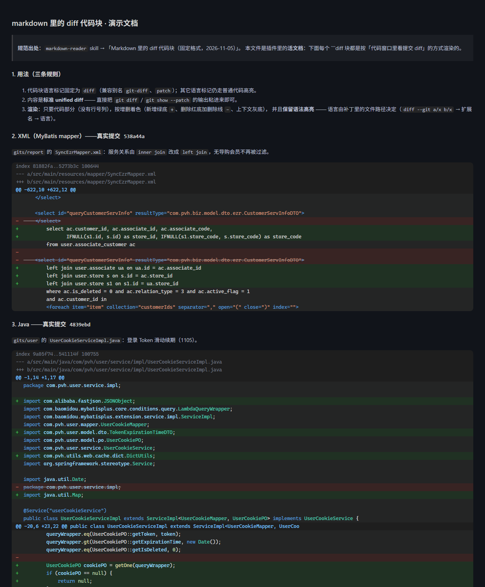

# markdown 里的 diff 代码块 · 演示文档

> **规范出处**：`markdown-reader` skill → 「Markdown 里的 diff 代码块（固定格式，2026-11-05）」。
> 本文件是插件里的**活文档**：下面每个 ```diff 块都是按「代码窗口里看提交 diff」的方式渲染的。



## 1. 用法（三条规则）

1. 代码块语言标记固定为 `diff`（兼容别名 `git-diff`、`patch`）；其它语言标记仍走普通代码高亮。
2. 内容是**标准 unified diff** —— 直接把 `git diff` / `git show --patch` 的输出粘进来即可。
3. **渲染**：只要代码部分（没有行号列），按增删着色（新增绿底 `+`、删除红底加删除线 `−`、上下文灰底），
   并且**保留语法高亮** —— 语言由补丁里的文件路径决定（`diff --git a/x b/x` → 扩展名 → 语言）。

## 2. XML（MyBatis mapper）——真实提交 `538a44a`

`gits/report` 的 `SyncEzrMapper.xml`：服务关系由 `inner join` 改成 `left join`，无导购会员不再被过滤。

```diff
diff --git a/src/main/resources/mapper/SyncEzrMapper.xml b/src/main/resources/mapper/SyncEzrMapper.xml
index 81882fa..5273b3c 100644
--- a/src/main/resources/mapper/SyncEzrMapper.xml
+++ b/src/main/resources/mapper/SyncEzrMapper.xml
@@ -622,10 +622,12 @@
     </select>
 
     <select id="queryCustomerServInfo" resultType="com.pvh.biz.model.dto.ezr.CustomerServInfoDTO">
-        select ac.customer_id, ac.associate_id, ac.associate_code, ua.store_id, s.store_code
+        select ac.customer_id, ac.associate_id, ac.associate_code,
+               IFNULL(s1.id, s.id) as store_id, IFNULL(s1.store_code, s.store_code) as store_code
         from user.associate_customer ac
-        inner join user.associate ua on ua.id = ac.associate_id
-        left join user.store s on s.id = ua.store_id
+        left join user.associate ua on ua.id = ac.associate_id
+        left join user.store s on s.id = ac.store_id
+        left join user.store s1 on s1.id = ua.store_id
         where ac.is_deleted = 0 and ac.relation_type = 3 and ac.active_flag = 1
         and ac.customer_id in
         <foreach item="item" collection="customerIds" separator="," open="(" close=")" index="">
```

## 3. Java ——真实提交 `4839ebd`

`gits/user` 的 `UserCookieServiceImpl.java`：登录 Token 滑动续期（1105）。

```diff
diff --git a/src/main/java/com/pvh/user/service/impl/UserCookieServiceImpl.java b/src/main/java/com/pvh/user/service/impl/UserCookieServiceImpl.java
index 9a05f74..541114f 100755
--- a/src/main/java/com/pvh/user/service/impl/UserCookieServiceImpl.java
+++ b/src/main/java/com/pvh/user/service/impl/UserCookieServiceImpl.java
@@ -1,14 +1,17 @@
 package com.pvh.user.service.impl;
 
+import com.alibaba.fastjson.JSONObject;
 import com.baomidou.mybatisplus.core.conditions.query.LambdaQueryWrapper;
 import com.baomidou.mybatisplus.extension.service.impl.ServiceImpl;
 import com.pvh.user.mapper.UserCookieMapper;
+import com.pvh.user.model.dto.TokenExpirationTimeDTO;
 import com.pvh.user.model.po.UserCookiePO;
 import com.pvh.user.service.UserCookieService;
+import com.pvh.utils.web.cache.dict.DictUtils;
 import org.springframework.stereotype.Service;
 
 import java.util.Date;
-import java.util.Optional;
+import java.util.Map;
 
 @Service("userCookieService")
 public class UserCookieServiceImpl extends ServiceImpl<UserCookieMapper, UserCookiePO> implements UserCookieService {
@@ -20,6 +23,22 @@ public class UserCookieServiceImpl extends ServiceImpl<UserCookieMapper, UserCoo
         queryWrapper.eq(UserCookiePO::getToken, token);
         queryWrapper.gt(UserCookiePO::getExpirationTime, new Date());
         queryWrapper.eq(UserCookiePO::getIsDeleted, 0);
-        return Optional.ofNullable(getOne(queryWrapper)).map(UserCookiePO::getUserId).orElse(null);
+        UserCookiePO cookiePO = getOne(queryWrapper);
+        if (cookiePO == null) {
+            return null;
+        }
+        // 校验通过即续期：固定重置为 now + 字典分钟数（不在旧值上累加），已过期会话不会走到这里
+        baseMapper.renewExpirationTime(token, resolveExpireMinutes());
+        return cookiePO.getUserId();
+    }
+
+    /**
+     * 续期分钟数：与登录发 token 使用同一字典 tokenExpirationTime，避免两处口径分叉
+     */
+    private int resolveExpireMinutes() {
+        Map<Object, Object> dict = DictUtils.getOtherMap("tokenExpirationTime");
+        TokenExpirationTimeDTO dto = JSONObject.parseObject(
+                JSONObject.toJSONString(dict), TokenExpirationTimeDTO.class);
+        return dto.getExpirationTime();
     }
 }
```

## 4. 一个代码块里放多个文件（按文件分段，各用各的语言）

同一个 `diff` 块里可以连续贴多个文件的补丁：**每段按自己的文件路径选语言**，互不影响。

```diff
diff --git a/src/main/resources/mapper/SyncEzrMapper.xml b/src/main/resources/mapper/SyncEzrMapper.xml
index 81882fa..5273b3c 100644
--- a/src/main/resources/mapper/SyncEzrMapper.xml
+++ b/src/main/resources/mapper/SyncEzrMapper.xml
@@ -622,10 +622,12 @@
     </select>
 
     <select id="queryCustomerServInfo" resultType="com.pvh.biz.model.dto.ezr.CustomerServInfoDTO">
-        select ac.customer_id, ac.associate_id, ac.associate_code, ua.store_id, s.store_code
+        select ac.customer_id, ac.associate_id, ac.associate_code,
+               IFNULL(s1.id, s.id) as store_id, IFNULL(s1.store_code, s.store_code) as store_code
         from user.associate_customer ac
-        inner join user.associate ua on ua.id = ac.associate_id
-        left join user.store s on s.id = ua.store_id
+        left join user.associate ua on ua.id = ac.associate_id
+        left join user.store s on s.id = ac.store_id
+        left join user.store s1 on s1.id = ua.store_id
         where ac.is_deleted = 0 and ac.relation_type = 3 and ac.active_flag = 1
         and ac.customer_id in
         <foreach item="item" collection="customerIds" separator="," open="(" close=")" index="">

diff --git a/src/main/java/com/pvh/user/service/impl/UserCookieServiceImpl.java b/src/main/java/com/pvh/user/service/impl/UserCookieServiceImpl.java
index 9a05f74..541114f 100755
--- a/src/main/java/com/pvh/user/service/impl/UserCookieServiceImpl.java
+++ b/src/main/java/com/pvh/user/service/impl/UserCookieServiceImpl.java
@@ -1,14 +1,17 @@
 package com.pvh.user.service.impl;
 
+import com.alibaba.fastjson.JSONObject;
 import com.baomidou.mybatisplus.core.conditions.query.LambdaQueryWrapper;
 import com.baomidou.mybatisplus.extension.service.impl.ServiceImpl;
 import com.pvh.user.mapper.UserCookieMapper;
+import com.pvh.user.model.dto.TokenExpirationTimeDTO;
 import com.pvh.user.model.po.UserCookiePO;
 import com.pvh.user.service.UserCookieService;
+import com.pvh.utils.web.cache.dict.DictUtils;
 import org.springframework.stereotype.Service;
 
 import java.util.Date;
-import java.util.Optional;
+import java.util.Map;
 
 @Service("userCookieService")
 public class UserCookieServiceImpl extends ServiceImpl<UserCookieMapper, UserCookiePO> implements UserCookieService {
@@ -20,6 +23,22 @@ public class UserCookieServiceImpl extends ServiceImpl<UserCookieMapper, UserCoo
         queryWrapper.eq(UserCookiePO::getToken, token);
         queryWrapper.gt(UserCookiePO::getExpirationTime, new Date());
         queryWrapper.eq(UserCookiePO::getIsDeleted, 0);
-        return Optional.ofNullable(getOne(queryWrapper)).map(UserCookiePO::getUserId).orElse(null);
+        UserCookiePO cookiePO = getOne(queryWrapper);
+        if (cookiePO == null) {
+            return null;
+        }
+        // 校验通过即续期：固定重置为 now + 字典分钟数（不在旧值上累加），已过期会话不会走到这里
+        baseMapper.renewExpirationTime(token, resolveExpireMinutes());
+        return cookiePO.getUserId();
+    }
+
+    /**
+     * 续期分钟数：与登录发 token 使用同一字典 tokenExpirationTime，避免两处口径分叉
+     */
+    private int resolveExpireMinutes() {
+        Map<Object, Object> dict = DictUtils.getOtherMap("tokenExpirationTime");
+        TokenExpirationTimeDTO dto = JSONObject.parseObject(
+                JSONObject.toJSONString(dict), TokenExpirationTimeDTO.class);
+        return dto.getExpirationTime();
     }
 }
```

## 5. 没有文件头的裸 hunk（没有语言 → 不高亮，只按增删着色）

不带 `diff --git` / `+++ b/…` 头时，无法判断语言，代码保持等宽原色，但增删样式照旧。

```diff
@@ -622,10 +622,12 @@
     </select>
 
     <select id="queryCustomerServInfo" resultType="com.pvh.biz.model.dto.ezr.CustomerServInfoDTO">
-        select ac.customer_id, ac.associate_id, ac.associate_code, ua.store_id, s.store_code
+        select ac.customer_id, ac.associate_id, ac.associate_code,
+               IFNULL(s1.id, s.id) as store_id, IFNULL(s1.store_code, s.store_code) as store_code
         from user.associate_customer ac
-        inner join user.associate ua on ua.id = ac.associate_id
+        left join user.associate ua on ua.id = ac.associate_id
         where ac.is_deleted = 0 and ac.relation_type = 3 and ac.active_flag = 1
```

## 6. **还没实施的改动**（设计阶段，手写补丁，没有对应提交）

**diff 不依赖提交。** 代码窗口里那个「按 commit 看 diff」是 git 能力；文档里的 ```diff 围栏
只是**渲染一段 unified diff 文本** —— 提交里导出的、手写的、还没实施的计划，都一样。

所以详设里写「打算怎么改」时，直接手写补丁即可（下面这段就是没有任何提交对应的计划）：

```diff
--- a/src/main/java/com/pvh/datax/service/SyncEzrService.java
+++ b/src/main/java/com/pvh/datax/service/SyncEzrService.java
@@ -38,8 +38,11 @@
     public List<SyncDataDTO> buildSyncStoreChange(SyncQuery query) {
-        return syncEzrMapper.buildSyncStoreChange(query.getStartDate(), query.getEndDate());
+        List<SyncDataDTO> all = new ArrayList<>();
+        Long lastId = 0L;
+        while (true) {
+            List<SyncDataDTO> page = syncEzrMapper.buildSyncStoreChange(lastId, PAGE_SIZE, query.getStartDate(), query.getEndDate());
+            if (page.isEmpty()) break;
+            all.addAll(page);
+            lastId = page.get(page.size() - 1).getId();
+        }
+        return all;
     }
```

要点：

- **文件头给语言**：`--- a/…` / `+++ b/…` 里的路径决定高亮语言（这里是 `.java`）；
- **hunk 头的行数只是参考**：写错了也不会丢内容（上面这段的计数就不准）；
- `-` 行是删掉的、`+` 行是新增的，其余是上下文。

## 7. 边界行为（规范里写死的几条）

| 情况 | 行为 |
|------|------|
| 补丁文本以换行结尾 | **不会**多出一行（hunk 头声明的行数是权威） |
| 删除行 | 正文带删除线，行号取**旧文件**行号（内部计算，不显示） |
| 新增行 | 绿底，行号取**新文件**行号（内部计算，不显示） |
| `\ No newline at end of file` | 暗色 meta 行 |
| 内容里带 HTML | 全部转义，不会注入页面 |
| 行很长 | 整块横向滚动 |

## 8. 相关工具

- 回归：`work/harnesses/diff-fence-check.mjs`（行模型/分段/转义/无幻影行/无行号列/计数写错不丢行）
- 真实渲染：`work/harnesses/diff-fence-render-check.mjs`（headless Chrome 跑真实客户端源码，断言确实无行号列、确实有语法高亮）
- 性能：`work/harnesses/md-perf-check.mjs`（带 mermaid 的文档：diff 全部渲染 + 主线程无长阻塞）
- 夹具：`work/fixtures/diff-fence-doc.md`（手写补丁 + mermaid 图，保留被删掉的那份详设的特征）
