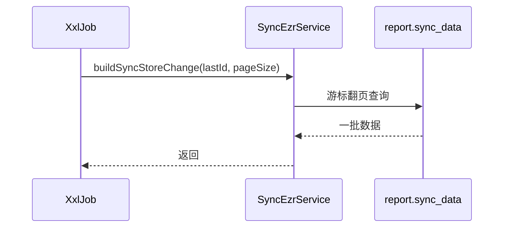

# diff 代码块夹具（手写补丁 + mermaid）

> 这是回归夹具，复制真实设计文档的特征：
> **手写的 hunk 头计数全部不准**（真实案例：19 个 ```diff 块，计数一个都不对），
> 外加一个 mermaid 图（真实案例里卡顿就发生在这个图前后）。

## 1. 手写补丁（计数写错）

```diff
--- a/src/main/java/com/pvh/datax/mapper/SyncEzrMapper.java
+++ b/src/main/java/com/pvh/datax/mapper/SyncEzrMapper.java
@@ -11,21 +11,21 @@

 public interface SyncEzrMapper {

-    List<SyncDataDTO> buildSyncStoreChange(@Param("startDate") Date startDate);
+    List<SyncDataDTO> buildSyncStoreChange(@Param("lastId") Long lastId, @Param("pageSize") Integer pageSize);

 }
```

## 2. 手写补丁（XML，只增不删）

```diff
--- a/src/main/resources/mapper/SyncEzrMapper.xml
+++ b/src/main/resources/mapper/SyncEzrMapper.xml
@@ -12,12 +12,15 @@
         LEFT JOIN report.sync_data b on a.id = b.ref_id and b.ref_type = #{refType}
         where a.is_deleted = 0
         and a.version > IFNULL(b.version, -1)
+        and a.id > #{lastId}
         <if test="startDate != null">
             AND a.update_time >= #{startDate}
         </if>
+        ORDER BY a.id ASC
+        LIMIT #{pageSize}
     </select>

```

## 3. 标准补丁（计数正确）

```diff
diff --git a/src/main/java/com/pvh/user/service/impl/UserCookieServiceImpl.java b/src/main/java/com/pvh/user/service/impl/UserCookieServiceImpl.java
index 9a05f74..541114f 100755
--- a/src/main/java/com/pvh/user/service/impl/UserCookieServiceImpl.java
+++ b/src/main/java/com/pvh/user/service/impl/UserCookieServiceImpl.java
@@ -20,6 +23,22 @@
         queryWrapper.eq(UserCookiePO::getToken, token);
         queryWrapper.gt(UserCookiePO::getExpirationTime, new Date());
         queryWrapper.eq(UserCookiePO::getIsDeleted, 0);
-        return Optional.ofNullable(getOne(queryWrapper)).map(UserCookiePO::getUserId).orElse(null);
+        UserCookiePO cookiePO = getOne(queryWrapper);
+        if (cookiePO == null) {
+            return null;
+        }
+        baseMapper.renewExpirationTime(token, resolveExpireMinutes());
+        return cookiePO.getUserId();
     }
```

## 4. mermaid 图（真实案例里卡顿发生在这里前后）



## 5. 普通代码块

```java
public List<SyncDataDTO> buildSyncStoreChange(@Param("lastId") Long lastId) {
    return null;
}
```
